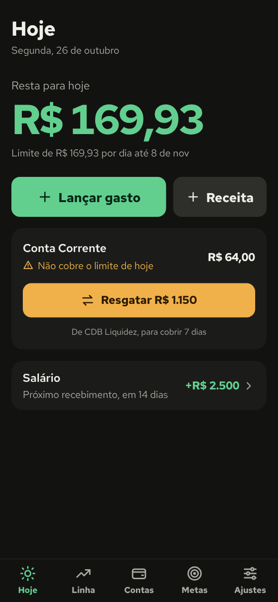
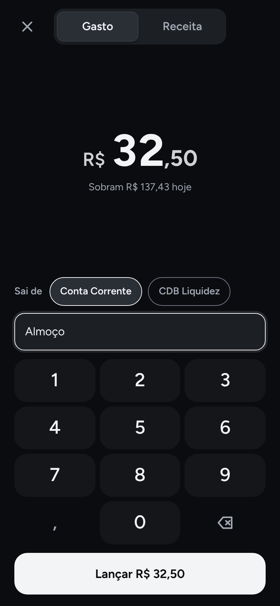
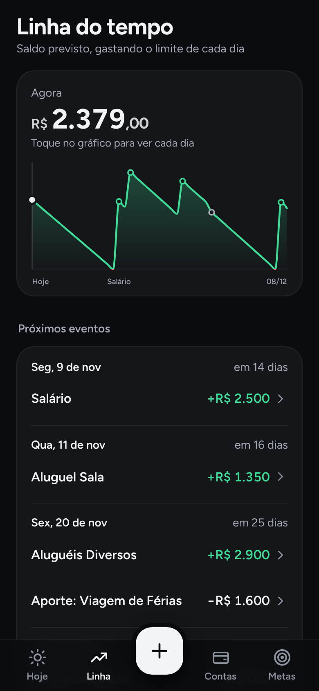
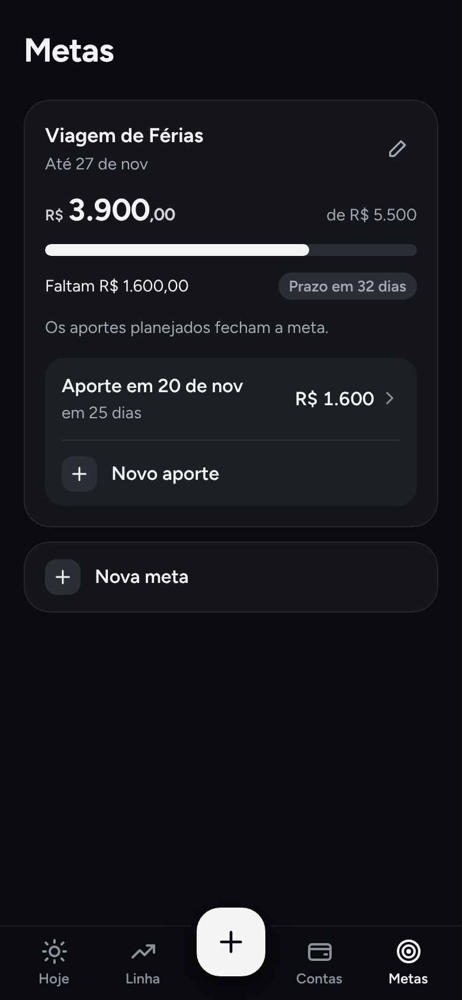

<div align="center">


# Hoje

**Quanto você pode gastar hoje sem faltar dinheiro até o próximo salário.**

PWA de finanças pessoais com orçamento diário dinâmico, offline e com backup criptografado.

</div>

<p align="center">
  
  
  
  
</p>

<p align="center"><sub>Telas com dados fictícios.</sub></p>

## Sumário

- [Visão geral](#visão-geral)
- [Funcionalidades](#funcionalidades)
- [Design](#design)
- [Como o orçamento é calculado](#como-o-orçamento-é-calculado)
- [Como a poupança é sugerida](#como-a-poupança-é-sugerida)
- [Privacidade e backup](#privacidade-e-backup)
- [Arquitetura](#arquitetura)
- [Começando](#começando)
- [Testes](#testes)
- [Deploy no Netlify](#deploy-no-netlify)
- [Instalação no celular](#instalação-no-celular)
- [Manutenção](#manutenção)
- [Limitações conhecidas](#limitações-conhecidas)

## Visão geral

Quem recebe em datas diferentes do mês e gasta todos os dias precisa de uma resposta simples: **quanto posso gastar hoje?** O Hoje calcula esse valor considerando o saldo real das contas, as receitas e despesas previstas e os aportes em metas, e recalcula tudo a cada dia.

O app foi feito para uso com uma mão no celular: um número grande, o botão de lançar sempre ao alcance do polegar e avisos só quando algo precisa de atenção.

| | |
|---|---|
| **Plataforma** | PWA instalável (Android e iOS), funciona 100% offline |
| **Stack** | HTML, CSS e JavaScript puros, sem framework e sem etapa de build |
| **Dados** | No aparelho (localStorage), com backup opcional criptografado na nuvem |
| **Servidor** | Uma única função no Netlify, que guarda só texto cifrado |
| **Idioma e moeda** | pt-BR, R$, datas no fuso `America/Sao_Paulo` |

## Funcionalidades

- **Quanto resta hoje:** o número em destaque é o que ainda pode ser gasto hoje, com uma barra que esvazia conforme o limite é usado. Logo abaixo aparece o limite de amanhã, que sobe quando sobra dinheiro hoje e cai quando o gasto passa do limite. Receita do dia ou atrasada só libera gasto depois de confirmada. Um toque no ícone de informação mostra a conta que leva ao limite.
- **Lançamento rápido de gastos e receitas:** o botão **+** fica na barra de abas, em todas as telas. Teclado numérico, só o valor; nome e conta são opcionais. Uma receita lançada entra no saldo na hora e aumenta o limite do dia. O nome sugere os já usados e pode ser trocado depois, tocando no lançamento.
- **Resgates planejados:** mostra quantos dias o saldo da conta de gastos cobre e sugere quanto resgatar da reserva (por exemplo, um CDB de liquidez diária), arredondado e limitado ao saldo disponível. Também sugere aplicar o excedente quando sobra dinheiro.
- **Receitas recorrentes e únicas:** dia fixo ou Nº dia útil do mês, com feriados nacionais (Sexta-feira Santa calculada pela Páscoa), opção de contar sábado e valor diferente em meses específicos. Receitas que acontecem uma única vez podem ser agendadas para uma data e entram no cálculo a partir dela.
- **Confirmação de entradas e saídas:** receitas, contas e aportes só mexem no saldo quando você confirma. Dá para confirmar antes da data, mudar a data de uma ocorrência ou marcar que não aconteceu.
- **Linha do tempo:** uma única linha, em SVG próprio, com o saldo previsto se você gastar o limite de cada dia, até um mês depois do próximo salário. O limite de cada dia futuro é refeito pela mesma conta que o app fará no dia. Tocar no gráfico mostra o saldo e os eventos de cada dia; abaixo fica a lista cronológica do que está por vir.
- **Contas:** saldos, uso de cada conta (gastos do dia, reserva ou nenhum), ajuste manual para conferir com o banco, transferências (que não contam como gasto) e movimentações agrupadas por dia.
- **Fatura de cartão:** uma despesa fixa marcada como cartão ganha uma fatura por mês, com os gastos discriminados (nome e valor), todos editáveis. Fica na aba Contas, em Cartões. Os gastos não saem do saldo; só o pagamento da fatura sai.
- **Poupança sugerida:** a cada receita, o app calcula quanto dá para guardar, até 10% do que entrou, sem apertar os seus dias. Guardar é registrar uma transferência para uma conta de meta, fora do limite.
- **Metas:** progresso, prazo e aportes planejados.
- **Ajustes:** receitas, despesas fixas, margem de segurança do limite, parâmetros de resgate, poupança e dados (backup na nuvem, exportar, importar). Abre pelo ícone no topo da tela Hoje. Cada informação mora em um lugar só.
- **Configuração guiada:** no primeiro acesso, um assistente cadastra contas, receitas, despesas, metas e parâmetros. Nenhum dado pessoal fica no código.

## Design

Tema escuro único, pensado para uma mão só. As regras que guiam cada tela:

- **Um número manda em cada tela.** Em Hoje, quanto resta para gastar; em Contas, o total nas contas de gasto; na Linha do tempo, o saldo do dia tocado.
- **Cor só aparece quando carrega um estado.** Verde: dinheiro que entra ou folga. Vermelho: dinheiro que falta ou ação que apaga. Âmbar: o app precisa de você (resgatar, confirmar). Todo o resto é neutro.
- **Ações são neutras.** A principal de cada tela é o botão claro; as secundárias, cinza. Lançar fica na barra de abas, ao alcance do polegar em qualquer tela.
- **Os mesmos sinais em todo lugar.** Gasto com −, receita com + em verde, transferência com ⇄ e sem cor.
- **Toque confortável e leitura garantida.** Alvos de toque de pelo menos 44 px, contraste AA nos textos e valores que encolhem para caber em telas estreitas.

A tipografia é a [Figtree](https://github.com/erikdkennedy/figtree) (licença OFL), servida pelo próprio app para funcionar offline.

## Como o orçamento é calculado

O cálculo é uma função pura, `computeDailyBudget(state, hoje)`, em [`app/js/core/budget.js`](app/js/core/budget.js).

1. **Dinheiro gastável:** soma dos saldos das contas de gasto, no início do dia (os gastos de hoje são somados de volta), menos a margem de segurança, se houver. Contas de meta ficam de fora.
2. **Janela:** de hoje até 12 meses à frente. Sem receita recorrente, até 30 dias depois da última receita prevista (sem nenhuma, 30 dias).
3. **Teste dia a dia:** para cada dia *k* da janela,

   ```
   disponível(k) = gastável + receitas previstas até k − despesas e aportes previstos até k
   limite        = min( disponível(k) ÷ dias de hoje até k )
   ```

   É o maior valor que dá para repetir todo dia sem faltar dinheiro em nenhum dia da janela. Um compromisso depois do próximo salário já pesa hoje, e uma sobra grande é repartida pelos meses seguintes, não gasta até o próximo salário.
4. **Receita a confirmar:** receita de hoje ou atrasada, ainda não confirmada, entra no limite, mas não libera gasto. Até a confirmação, "Resta para gastar" é o que caberia sem ela.

**Exemplo:** R$ 2.379 nas contas de gasto, salário em 9/11 e nenhum outro evento até lá. O dia mais apertado é 8/11, véspera do salário (14 dias), e o limite é R$ 2.379 ÷ 14 = **R$ 169,93 por dia**. Se você gastar R$ 100 a menos hoje, a sobra é repartida até 6/12, véspera do salário seguinte. Com R$ 6.750 de receitas e R$ 1.780 de despesas e aportes previstos até lá, amanhã o limite sobe para (2.379 − 69,93 + 6.750 − 1.780) ÷ 41 = R$ 177,54.

**Regras complementares**

- Transferências entre contas de gasto (como um resgate) não alteram o limite.
- Ocorrências vencidas e não confirmadas contam como previstas para hoje.
- Confirmar uma ocorrência no valor previsto, no dia ou atrasada, não muda o limite.
- "Amanhã" é a mesma conta um dia à frente, com o saldo de agora.
- A margem de segurança (Ajustes) é um valor nas contas de gasto que o limite nunca usa. O padrão é zero.
- Valores são guardados em centavos inteiros, e datas como strings `AAAA-MM-DD`, para evitar erros de ponto flutuante e de fuso horário.

**Fatura de cartão** ([`app/js/core/invoice.js`](app/js/core/invoice.js)): para uma despesa fixa marcada como cartão, o valor do mês segue a fatura.

- Sem gastos lançados: o valor previsto da despesa (ou o valor diferente daquele mês).
- Fatura aberta: o maior entre o previsto e a soma dos gastos. Uma lista incompleta nunca aumenta o limite.
- Fatura fechada: a soma dos gastos.
- Paga ou pulada: nada, como qualquer ocorrência confirmada.

Os gastos da fatura não mexem em saldo nem contam como gasto do dia.

**Sugestão de resgate** ([`app/js/core/refill.js`](app/js/core/refill.js)): `limite × dias desejados + compromissos da conta no período − saldo atual`, arredondado para cima em múltiplos de R$ 50 e limitado ao saldo da reserva. Se uma receita cair na conta antes do fim do período, o resgate cobre só até ela.

## Como a poupança é sugerida

A cada receita que entra numa conta de gasto, o app sugere quanto guardar ([`app/js/core/savings.js`](app/js/core/savings.js)):

```
teto     = 10% do que entrou
piso     = 90% do que você gastou por dia nos últimos 30 dias
           (sem 7 dias de gastos lançados: 90% do limite de hoje)
sugestão = o maior valor em reais inteiros, até o teto e até o saldo da conta,
           que deixa o limite do dia igual ou acima do piso
```

Nada é sugerido quando o limite está zerado ou abaixo do piso, nem quando o valor ficaria abaixo de R$ 10 ou de 1% da receita. Guardar é registrar uma transferência para uma conta de meta, que fica fora do limite. O limite só muda quando você aceita. Em meses normais a sugestão chega a 10%; em meses apertados, encolhe ou some.

## Privacidade e backup

Os dados ficam no aparelho. O backup na nuvem é opcional e foi desenhado para que o servidor nunca consiga ler as informações.

| Etapa | Como funciona |
|---|---|
| **Código de recuperação** | 24 caracteres (120 bits) gerados no aparelho, com alfabeto que evita letras ambíguas |
| **Chaves** | O código passa por HKDF-SHA-256 e gera duas coisas: o identificador do backup e a chave AES-256-GCM |
| **Envio** | A cada mudança, os dados são comprimidos (gzip), cifrados e enviados; o código nunca sai do aparelho |
| **Armazenamento** | A função `/api/sync` grava só o envelope cifrado no Netlify Blobs |
| **Concorrência** | Cada gravação informa a revisão que conhece; se outro aparelho gravou antes, o app pergunta qual versão manter |

Isso resolve três situações comuns no iPhone: o Safari e o app instalado guardam dados separados, remover o ícone apaga os dados do app e trocar de celular. Basta restaurar com o código.

> [!IMPORTANT]
> Sem o código de recuperação, ninguém consegue abrir o backup, nem o próprio dono. Guarde-o em um gerenciador de senhas.

Também é possível exportar e importar um arquivo JSON em **Ajustes**.

## Arquitetura

```
hoje_app/
├── app/                         site publicado (estático)
│   ├── index.html
│   ├── manifest.webmanifest
│   ├── sw.js                    service worker: cache-first, offline
│   ├── css/app.css              tema escuro, tokens de design
│   ├── fonts/                   Figtree (licença OFL), servida pelo próprio app
│   ├── icons/
│   └── js/
│       ├── app.js               roteador, renderização, virada de dia
│       ├── core/                lógica pura, sem DOM (testada no Node)
│       │   ├── budget.js        limite diário
│       │   ├── savings.js       sugestão de poupança a cada receita
│       │   ├── invoice.js       fatura de cartão (resumo e validação)
│       │   ├── refill.js        cobertura e sugestão de resgate
│       │   ├── schedule.js      recorrências, pendências e datas mudadas
│       │   ├── businessDays.js  Páscoa, feriados e Nº dia útil
│       │   ├── projection.js    saldo previsto dia a dia (linha do tempo)
│       │   ├── vault.js         criptografia do backup
│       │   ├── dates.js         datas sem fuso
│       │   └── money.js         centavos e formatação pt-BR
│       ├── data/                estado, lançamentos e sincronização
│       └── ui/                  componentes, formulários e telas
├── netlify/
│   ├── functions/sync.mjs       função /api/sync
│   └── lib/sync-core.mjs        API do backup, independente do Netlify
├── tests/                       testes (node --test)
├── tools/gen-icons.py           gera os ícones PNG
└── netlify.toml
```

**Princípios**

- A lógica de negócio em `app/js/core/` é pura e determinística: recebe o estado e a data, devolve números. Nada nela acessa DOM, armazenamento ou relógio.
- A interface é renderizada a partir do estado a cada mudança, sem framework.
- O servidor é mínimo e não conhece o conteúdo dos dados.

## Começando

**Requisitos:** Node.js 22.12 ou superior e Python 3 (só para servir os arquivos localmente).

```bash
git clone https://github.com/luizalexandrepaiva/hoje_app.git
cd hoje_app
npm install        # dependência da função do servidor
npm start          # serve app/ em http://localhost:8080
```

O service worker funciona em `localhost` sem HTTPS. O comando `npm start` serve apenas o site; para testar também o backup na nuvem localmente, use `npx netlify dev`, que executa a função `/api/sync` com um armazenamento local.

## Testes

```bash
npm test
```

São 127 testes com o executor nativo do Node, sem dependências externas.

| Arquivo | Cobertura |
|---|---|
| `tests/budget.test.js` | Limite diário (critérios de aceitação), gastos do dia, recálculo, salário, datas mudadas e confirmações antecipadas |
| `tests/limit.test.js` | Janela de 12 meses, receita a confirmar, margem de segurança e projeção igual à simulação dia a dia |
| `tests/invoice.test.js` | Fatura de cartão: previsto, aberta e fechada, pagamento, datas mudadas, backup antigo e importação suja |
| `tests/savings.test.js` | Sugestão de poupança: teto, piso, mês apertado, saldo da conta, várias receitas e janela de 7 dias |
| `tests/refill.test.js` | Cobertura, sugestão de resgate, corte por receita, limite da reserva e excedente |
| `tests/businessDays.test.js` | Páscoa, feriados nacionais, Nº dia útil, regra do sábado e datas sem erro de fuso |
| `tests/schedule.test.js` | Recorrências, receitas únicas, pendências e ocorrências com data mudada |
| `tests/money.test.js` | Leitura e formatação de valores em pt-BR |
| `tests/store.test.js` | Receitas lançadas na hora, nome e renomeação de lançamentos, sugestões de nomes, uso das contas |
| `tests/vault.test.js` | Código de recuperação, derivação de chaves, cifra e adulteração |
| `tests/sync-core.test.js` | API do backup: revisões, conflitos, corrida entre aparelhos e validação |

Os testes usam um cenário fictício ([`tests/fixtures.js`](tests/fixtures.js)) equivalente ao da especificação e verificam os critérios de aceitação: 5º dia útil de novembro de 2026 em 9/11, limite de R$ 169,93, cobertura de 0 dias com resgate sugerido de R$ 1.150 e resgate sem efeito no limite.

## Deploy no Netlify

O [`netlify.toml`](netlify.toml) já define tudo: publica a pasta `app/`, cria a função `/api/sync` e envia o `sw.js` sem cache. O Netlify Blobs é ativado automaticamente para a função.

1. Em [app.netlify.com](https://app.netlify.com), escolha **Add new project → Import an existing project → GitHub**.
2. Selecione o repositório e a branch `main`. Deixe o comando de build vazio; a pasta publicada vem do `netlify.toml`.
3. Clique em **Deploy**. Cada `git push` na `main` publica uma nova versão.

Para esconder a barra de colaboração do Netlify, desative o **Netlify Drawer** em *Project configuration → Developer settings → Collaboration tools*.

## Instalação no celular

| Sistema | Passos |
|---|---|
| **Android (Chrome)** | Abra o endereço do site, toque no menu ⋮ e em **Instalar app** |
| **iPhone (Safari)** | Abra o endereço no Safari, toque em Compartilhar e em **Adicionar à Tela de Início** |

Abra o app uma vez com internet; depois disso ele funciona offline. Use sempre o endereço principal do site, porque endereços de prévia de deploy guardam dados separados.

## Manutenção

**Publicar uma nova versão:** ao alterar qualquer arquivo em `app/`, aumente `CACHE_VERSION` em [`app/sw.js`](app/sw.js) e `APP_VERSION` em [`app/js/version.js`](app/js/version.js). O celular baixa a nova versão na primeira abertura e a exibe na seguinte.

**Ícones:** `python3 tools/gen-icons.py` gera os PNGs (requer Pillow e a fonte Inter).

**Convenções**

- Valores monetários sempre em centavos inteiros (`number`).
- Datas sempre como `AAAA-MM-DD`; "hoje" vem de `todayISO()`, no fuso de São Paulo.
- Lógica nova de cálculo vai para `app/js/core/`, com teste correspondente em `tests/`.
- Dados pessoais nunca entram no código nem nos testes; use valores fictícios.

## Limitações conhecidas

- Considera apenas feriados nacionais; feriados estaduais, municipais e pontos facultativos (como o Carnaval) não entram na contagem de dias úteis.
- Uma única moeda (R$) e um único usuário por backup.
- No iPhone, o Safari e o app instalado não compartilham dados automaticamente; a sincronização entre eles depende do backup na nuvem.
- Recorrências são mensais; despesas semanais ou anuais precisam ser lançadas como exceções ou gastos avulsos.
- O limite olha 12 meses à frente e confia nas receitas e despesas fixas cadastradas. Se as despesas fixas passam das receitas no período, o app mostra "Sem folga" desde já. Meses futuros usam o valor cadastrado de cada despesa fixa, ou o valor diferente daquele mês, se houver.
- Sem receita recorrente cadastrada a janela é de 30 dias, e o limite pode cair quando uma despesa entra nela.
- Fatura de cartão: sem parcelamento, sem itens negativos (estornos) e sem pagamento parcial.
- A poupança sugerida registra a transferência; o dinheiro é movido por você no banco.
