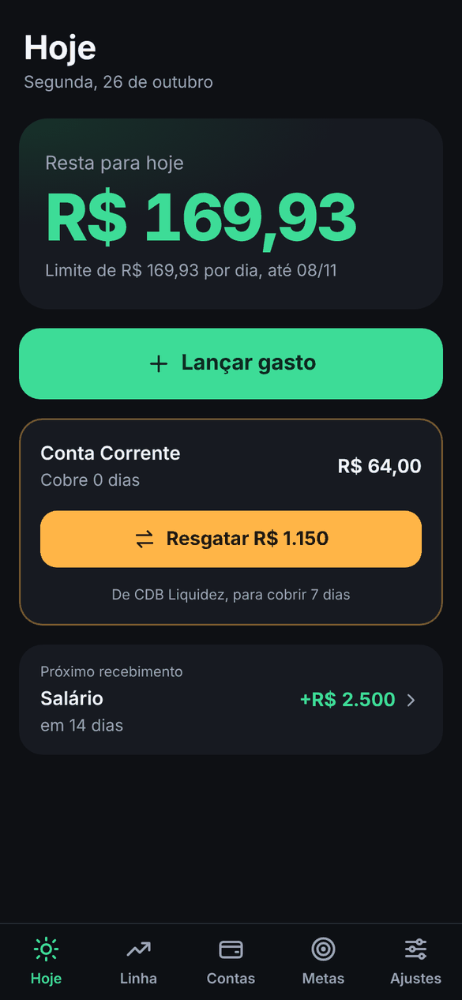
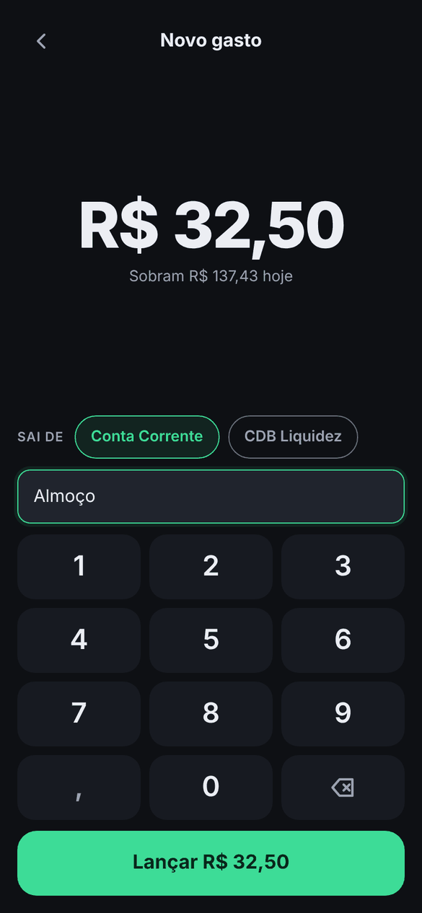
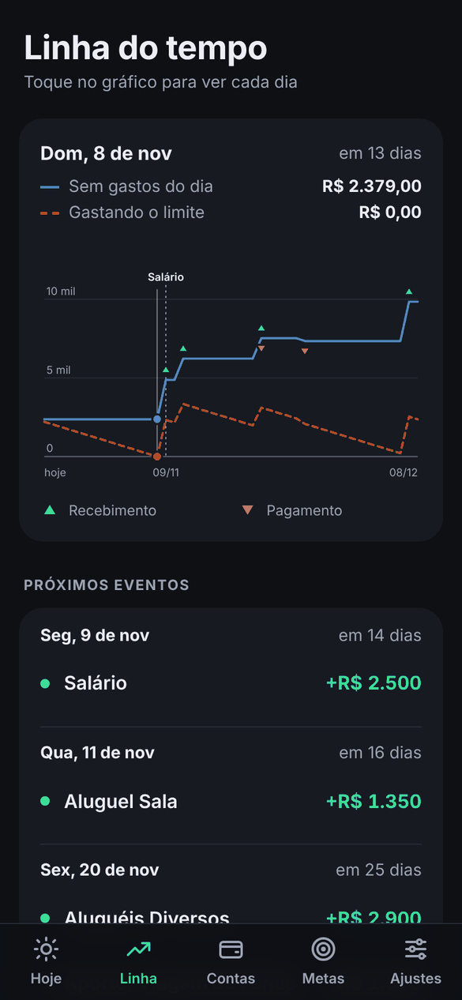
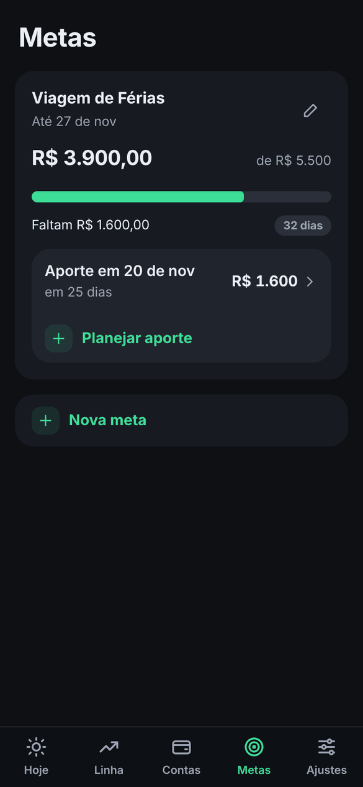

<div align="center">


# Hoje

**Quanto você pode gastar hoje sem faltar dinheiro até o próximo salário.**

PWA de finanças pessoais com orçamento diário dinâmico, offline e com backup criptografado.

</div>

<p align="center">
  
  
  
  
</p>

<p align="center"><sub>Telas com dados fictícios.</sub></p>

## Sumário

- [Visão geral](#visão-geral)
- [Funcionalidades](#funcionalidades)
- [Como o orçamento é calculado](#como-o-orçamento-é-calculado)
- [Privacidade e backup](#privacidade-e-backup)
- [Arquitetura](#arquitetura)
- [Começando](#começando)
- [Testes](#testes)
- [Deploy no Netlify](#deploy-no-netlify)
- [Instalação no celular](#instalação-no-celular)
- [Manutenção](#manutenção)
- [Limitações conhecidas](#limitações-conhecidas)

## Visão geral

Quem recebe em datas diferentes do mês e gasta todos os dias precisa de uma resposta simples: **quanto posso gastar hoje?** O Hoje calcula esse valor considerando o saldo real das contas, as receitas e despesas previstas e os aportes em metas, e recalcula tudo a cada dia.

O app foi feito para uso com uma mão no celular: um número grande, um botão para lançar gasto e avisos só quando algo precisa de atenção.

| | |
|---|---|
| **Plataforma** | PWA instalável (Android e iOS), funciona 100% offline |
| **Stack** | HTML, CSS e JavaScript puros, sem framework e sem etapa de build |
| **Dados** | No aparelho (localStorage), com backup opcional criptografado na nuvem |
| **Servidor** | Uma única função no Netlify, que guarda só texto cifrado |
| **Idioma e moeda** | pt-BR, R$, datas no fuso `America/Sao_Paulo` |

## Funcionalidades

- **Quanto resta hoje:** o número em destaque é o que ainda pode ser gasto hoje. Logo abaixo aparece o limite diário, calculado para não faltar dinheiro até a véspera do próximo salário. No dia seguinte, sobras e excessos se redistribuem.
- **Lançamento rápido:** teclado numérico, só o valor; nome e conta são opcionais. O nome sugere os já usados e pode ser trocado depois, tocando no gasto.
- **Resgates planejados:** mostra quantos dias o saldo da conta de gastos cobre e sugere quanto resgatar da reserva (por exemplo, um CDB de liquidez diária), arredondado e limitado ao saldo disponível. Também sugere aplicar o excedente quando sobra dinheiro.
- **Receitas recorrentes:** dia fixo ou Nº dia útil do mês, com feriados nacionais (Sexta-feira Santa calculada pela Páscoa), opção de contar sábado e valor diferente em meses específicos.
- **Confirmação de entradas e saídas:** receitas, contas e aportes só mexem no saldo quando você confirma. Dá para confirmar antes da data, mudar a data de uma ocorrência ou marcar que não aconteceu.
- **Linha do tempo:** gráfico próprio em SVG com o saldo projetado até um mês depois do próximo salário e a lista cronológica dos eventos.
- **Contas e metas:** saldos, ajuste manual para conferir com o banco, transferências (que não contam como gasto) e metas com progresso, prazo e aportes planejados.
- **Configuração guiada:** no primeiro acesso, um assistente cadastra contas, receitas, despesas, metas e parâmetros. Nenhum dado pessoal fica no código.

## Como o orçamento é calculado

O cálculo é uma função pura, `computeDailyBudget(state, hoje)`, em [`app/js/core/budget.js`](app/js/core/budget.js).

1. **Dinheiro gastável:** soma dos saldos das contas de gasto, no início do dia (os gastos de hoje são somados de volta). Contas de meta ficam de fora.
2. **Horizonte:** de hoje até a véspera do próximo salário ainda não recebido. Se hoje é dia de salário, vai até a véspera do salário seguinte.
3. **Teste dia a dia:** para cada dia *k* do horizonte,

   ```
   disponível(k) = gastável + receitas previstas até k − despesas e aportes previstos até k
   orçamento     = min( disponível(k) ÷ dias de hoje até k )
   ```

   Usar o menor valor garante que nenhum compromisso no meio do período fique descoberto e que o app não conte com dinheiro que ainda não chegou.

**Exemplo:** R$ 2.379 nas contas de gasto, salário em 9/11 e nenhum outro evento até lá. O horizonte vai de 26/10 a 8/11 (14 dias), e o limite é R$ 2.379 ÷ 14 = **R$ 169,93 por dia**. Se você gastar R$ 100 a menos hoje, amanhã o limite sobe para (2.379 − 69,93) ÷ 13 = R$ 177,62.

**Regras complementares**

- Transferências entre contas de gasto (como um resgate) não alteram o limite.
- Ocorrências vencidas e não confirmadas contam como previstas para hoje.
- Valores são guardados em centavos inteiros, e datas como strings `AAAA-MM-DD`, para evitar erros de ponto flutuante e de fuso horário.

**Sugestão de resgate** ([`app/js/core/refill.js`](app/js/core/refill.js)): `limite × dias desejados + compromissos da conta no período − saldo atual`, arredondado para cima em múltiplos de R$ 50 e limitado ao saldo da reserva. Se uma receita cair na conta antes do fim do período, o resgate cobre só até ela.

## Privacidade e backup

Os dados ficam no aparelho. O backup na nuvem é opcional e foi desenhado para que o servidor nunca consiga ler as informações.

| Etapa | Como funciona |
|---|---|
| **Código de recuperação** | 24 caracteres (120 bits) gerados no aparelho, com alfabeto que evita letras ambíguas |
| **Chaves** | O código passa por HKDF-SHA-256 e gera duas coisas: o identificador do backup e a chave AES-256-GCM |
| **Envio** | A cada mudança, os dados são comprimidos (gzip), cifrados e enviados; o código nunca sai do aparelho |
| **Armazenamento** | A função `/api/sync` grava só o envelope cifrado no Netlify Blobs |
| **Concorrência** | Cada gravação informa a revisão que conhece; se outro aparelho gravou antes, o app pergunta qual versão manter |

Isso resolve três situações comuns no iPhone: o Safari e o app instalado guardam dados separados, remover o ícone apaga os dados do app e trocar de celular. Basta restaurar com o código.

> [!IMPORTANT]
> Sem o código de recuperação, ninguém consegue abrir o backup, nem o próprio dono. Guarde-o em um gerenciador de senhas.

Também é possível exportar e importar um arquivo JSON em **Ajustes**.

## Arquitetura

```
hoje_app/
├── app/                         site publicado (estático)
│   ├── index.html
│   ├── manifest.webmanifest
│   ├── sw.js                    service worker: cache-first, offline
│   ├── css/app.css              tema escuro, tokens de design
│   ├── icons/
│   └── js/
│       ├── app.js               roteador, renderização, virada de dia
│       ├── core/                lógica pura, sem DOM (testada no Node)
│       │   ├── budget.js        limite diário
│       │   ├── refill.js        cobertura e sugestão de resgate
│       │   ├── schedule.js      recorrências, pendências e datas mudadas
│       │   ├── businessDays.js  Páscoa, feriados e Nº dia útil
│       │   ├── projection.js    série do gráfico
│       │   ├── vault.js         criptografia do backup
│       │   ├── dates.js         datas sem fuso
│       │   └── money.js         centavos e formatação pt-BR
│       ├── data/                estado, lançamentos e sincronização
│       └── ui/                  componentes, formulários e telas
├── netlify/
│   ├── functions/sync.mjs       função /api/sync
│   └── lib/sync-core.mjs        API do backup, independente do Netlify
├── tests/                       testes (node --test)
├── tools/gen-icons.py           gera os ícones PNG
└── netlify.toml
```

**Princípios**

- A lógica de negócio em `app/js/core/` é pura e determinística: recebe o estado e a data, devolve números. Nada nela acessa DOM, armazenamento ou relógio.
- A interface é renderizada a partir do estado a cada mudança, sem framework.
- O servidor é mínimo e não conhece o conteúdo dos dados.

## Começando

**Requisitos:** Node.js 22.12 ou superior e Python 3 (só para servir os arquivos localmente).

```bash
git clone https://github.com/luizalexandrepaiva/hoje_app.git
cd hoje_app
npm install        # dependência da função do servidor
npm start          # serve app/ em http://localhost:8080
```

O service worker funciona em `localhost` sem HTTPS. O comando `npm start` serve apenas o site; para testar também o backup na nuvem localmente, use `npx netlify dev`, que executa a função `/api/sync` com um armazenamento local.

## Testes

```bash
npm test
```

São 60 testes com o executor nativo do Node, sem dependências externas.

| Arquivo | Cobertura |
|---|---|
| `tests/budget.test.js` | Limite diário (critérios de aceitação), gastos do dia, recálculo, salário, datas mudadas e confirmações antecipadas |
| `tests/refill.test.js` | Cobertura, sugestão de resgate, corte por receita, limite da reserva e excedente |
| `tests/businessDays.test.js` | Páscoa, feriados nacionais, Nº dia útil, regra do sábado e datas sem erro de fuso |
| `tests/schedule.test.js` | Recorrências, pendências e ocorrências com data mudada |
| `tests/money.test.js` | Leitura e formatação de valores em pt-BR |
| `tests/store.test.js` | Nome e renomeação de gastos, sugestões de nomes |
| `tests/vault.test.js` | Código de recuperação, derivação de chaves, cifra e adulteração |
| `tests/sync-core.test.js` | API do backup: revisões, conflitos, corrida entre aparelhos e validação |

Os testes usam um cenário fictício ([`tests/fixtures.js`](tests/fixtures.js)) equivalente ao da especificação e verificam os critérios de aceitação: 5º dia útil de novembro de 2026 em 9/11, limite de R$ 169,93, cobertura de 0 dias com resgate sugerido de R$ 1.150 e resgate sem efeito no limite.

## Deploy no Netlify

O [`netlify.toml`](netlify.toml) já define tudo: publica a pasta `app/`, cria a função `/api/sync` e envia o `sw.js` sem cache. O Netlify Blobs é ativado automaticamente para a função.

1. Em [app.netlify.com](https://app.netlify.com), escolha **Add new project → Import an existing project → GitHub**.
2. Selecione o repositório e a branch `main`. Deixe o comando de build vazio; a pasta publicada vem do `netlify.toml`.
3. Clique em **Deploy**. Cada `git push` na `main` publica uma nova versão.

Para esconder a barra de colaboração do Netlify, desative o **Netlify Drawer** em *Project configuration → Developer settings → Collaboration tools*.

## Instalação no celular

| Sistema | Passos |
|---|---|
| **Android (Chrome)** | Abra o endereço do site, toque no menu ⋮ e em **Instalar app** |
| **iPhone (Safari)** | Abra o endereço no Safari, toque em Compartilhar e em **Adicionar à Tela de Início** |

Abra o app uma vez com internet; depois disso ele funciona offline. Use sempre o endereço principal do site, porque endereços de prévia de deploy guardam dados separados.

## Manutenção

**Publicar uma nova versão:** ao alterar qualquer arquivo em `app/`, aumente `CACHE_VERSION` em [`app/sw.js`](app/sw.js) e `APP_VERSION` em [`app/js/version.js`](app/js/version.js). O celular baixa a nova versão na primeira abertura e a exibe na seguinte.

**Ícones:** `python3 tools/gen-icons.py` gera os PNGs (requer Pillow e a fonte Inter).

**Convenções**

- Valores monetários sempre em centavos inteiros (`number`).
- Datas sempre como `AAAA-MM-DD`; "hoje" vem de `todayISO()`, no fuso de São Paulo.
- Lógica nova de cálculo vai para `app/js/core/`, com teste correspondente em `tests/`.
- Dados pessoais nunca entram no código nem nos testes; use valores fictícios.

## Limitações conhecidas

- Considera apenas feriados nacionais; feriados estaduais, municipais e pontos facultativos (como o Carnaval) não entram na contagem de dias úteis.
- Uma única moeda (R$) e um único usuário por backup.
- No iPhone, o Safari e o app instalado não compartilham dados automaticamente; a sincronização entre eles depende do backup na nuvem.
- Recorrências são mensais; despesas semanais ou anuais precisam ser lançadas como exceções ou gastos avulsos.
